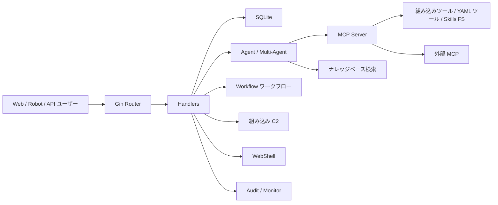

# アーキテクチャ

[English](../en-US/architecture.md) | [中文](../zh-CN/architecture.md)

CyberStrikeAI は、Web 管理画面を入口とし、エージェントと MCP ツールを実行の中核とする、セキュリティテストのオーケストレーションプラットフォームです。

## 概要

## Web 層

エントリーポイントは `cmd/server/` にあり、アプリケーションの組み立ては `internal/app/` にあります。Web には Gin を使用しています。

- `web/frontend/`：フロントエンドのソース（React 19 + Semi Design、Vite でビルド）。ページは `src/pages/<ページ id>/` にあります。
- `web/static/app/`：フロントエンドのビルド成果物。`GET /` はその中の `index.html` を直接返し、`/api-docs` は `/#/api-docs` にリダイレクトされます。
- `web/static/i18n/`：多言語の文言。フロントエンドとバックエンドで共有します。
- `web/static/`：ロゴ、favicon、多言語などの公開静的リソース。

ルート登録は `internal/app/app.go` に集約されています。

## Handler 層

`internal/handler/` は業務ごとに分割されています。

- `agent.go`、`single_agent.go`、`multi_agent.go`
- `workflow.go`、`workflow_run.go`
- `knowledge.go`
- `webshell.go`
- `c2.go`
- `audit.go`
- `monitor.go`
- `project.go`
- `vulnerability.go`
- `config.go`
- `openapi.go`

Handler は、パラメーターの解析、権限ミドルウェアを通過した後の業務の調整、HTTP レスポンスを担当します。

## エージェント層

シングルエージェントとマルチエージェントは、主に次の場所にあります。

- `internal/agent/`
- `internal/multiagent/`
- `internal/agents/`
- `agents/`

デフォルトのランタイムは Pi TypeScript SDK です。`internal/agentruntime/` がサブプロセスのプロトコルとビルドを管理し、`internal/multiagent/pi_*.go` がロール、ツール、承認、イベントのアダプテーションを担当します。シングルエージェントおよび Deep、Plan-Execute、Supervisor はいずれも Pi セッションを使用し、ロールは引き続き Markdown で定義されます。旧フレームワークのカーネルと依存関係は削除済みで、ランタイムは Pi のみをサポートします。詳細は [Pi ランタイム](pi-runtime.md) を参照してください。

## MCP とツール

MCP 関連：

- `internal/mcp/`：Server、外部 MCP、接続の復旧。
- `internal/agentruntime/` と `internal/multiagent/pi_runner.go`：Pi と Go の MCP 実行チェーンのアダプテーション。`internal/agentruntime/` は Pi 互換パスとして残されています。
- `tools/`：YAML コマンドツール。
- `internal/app/*_tools.go`：Go 組み込みツールの登録。

ツール呼び出しは監視記録に入り、HITL 承認の影響を受ける場合があります。

## Workflow

ワークフローエンジンは `internal/workflow/` にあり、HTTP の入口は `internal/handler/workflow*.go` にあります。ネイティブ DAG エグゼキューターは start、agent、tool、condition、hitl、output、end などのノードをサポートし、バージョン管理された JSON チェックポイントで復旧状態を保存します。

詳しい使い方は [ワークフロー利用ガイド](workflow-graph.md) を参照してください。

## ナレッジベース

ナレッジベースは `internal/knowledge/` にあり、次の内容を含みます。

- Markdown/テキストコンテンツの管理。
- chunk。
- embedding。
- SQLite ベクトルインデックス。
- multi-query。
- rerank。
- 検索ログ。

有効化すると、エージェントにナレッジ検索ツールが公開されます。

## データ層

`internal/database/` が SQLite へのアクセスをカプセル化し、次の内容を保存します。

- 会話、メッセージ、プロセス詳細。
- グループ。
- ツール実行記録。
- HITL ログ。
- ナレッジベースのインデックスと検索ログ。
- WebShell、C2、プロジェクト、脆弱性、バッチタスクなどの業務データ。

デフォルトのデータベースファイル：

- `data/conversations.db`
- `data/knowledge.db`

## セキュリティと監査

`internal/security/` は、認証、レート制限、Shell 実行、コマンドストリーム処理を提供します。`internal/audit/` と `internal/monitor/` は、それぞれプラットフォームの監査と実行監視を担当します。

高リスクなモジュールは次のとおりです。

- Terminal。
- WebShell。
- C2。
- 外部 MCP。
- ファイルシステムと Shell Skills。

これらのモジュールは、ロール、HITL、デプロイ環境の分離と組み合わせて使用してください。

## 会話リクエストの実際の経路

`/api/agent/stream` を例に説明します。

1. Gin のルートが認証ミドルウェアに入ります。
2. Handler がリクエストボディ、会話 ID、ロール、添付ファイル、WebShell コンテキストを解析します。
3. エージェントが、履歴メッセージ、ロールのプロンプト、プロジェクトのファクト、ツール一覧を含むモデル入力を構築します。
4. Pi Worker がモデルを呼び出し、Go がライフサイクルイベントを受け取ります。
5. モデルがツールを必要とする場合、双方向プロトコルを通じて Go のツールゲートウェイに戻り、MCP またはネイティブツールに入ります。
6. ツール呼び出しの前に HITL が発動する場合があります。
7. ツールの実行結果はプロセス詳細と監視に書き込まれます。
8. モデルが推論を続け、最終回答を生成します。
9. SSE が、進捗、ツールイベント、テキストの差分をフロントエンドにプッシュします。
10. 会話、メッセージ、プロセス詳細が SQLite に書き込まれます。

この経路から、問題が多くの層で発生し得る理由がわかります。認証、会話、モデル、ツール、HITL、MCP、データベース、SSE、フロントエンドのレンダリングのいずれもが原因になり得ます。

## 横断的なモジュール依存

いくつかのモジュールは独立したページではなく、横断的な機能です。

- Project facts：エージェントのコンテキストに注入され、複数ターンや会話をまたぐ判断に影響します。
- HITL：ツール呼び出しの前に挿入され、すべてのエージェント/MCP ツールに影響します。
- Monitor：ツールの実行を記録し、タスクのキャンセル、振り返り、通知に影響します。
- Audit：プラットフォームの管理操作を記録し、セキュリティ運用に影響します。
- Tool search：モデルにどのツールが見えるかに影響します。ツールページに表示される内容だけではありません。

これらのモジュールを変更する際は、単一のページだけをテストするのではなく、全体の呼び出し箇所を確認してください。

## 複雑度のホットスポット

メンテナンスの際は、次の箇所に優先的に注意してください。

- `internal/app/app.go`：すべてのサービスを組み立てており、初期化順序の問題を招きやすい。
- `internal/handler/config.go`：設定をホット適用し、モデル、ナレッジベース、C2、ボット、MCP に影響する。
- `internal/multiagent/`：ミドルウェアが多く、ストリーミング、リトライ、要約、ツール呼び出しが入り組んでいる。
- `internal/security/`：Shell と認証がセキュリティ境界である。
- `internal/database/`：SQLite のスキーマ進化は、既存データとの互換性を保たなければならない。

## 設計上のトレードオフ

本プロジェクトがモノリシックな Go サービス + SQLite + 静的フロントエンドを選択したのは、デプロイの敷居を下げるためです。ただし、その代償として次の点があります。

- 複数インスタンスでの水平スケールは自然には成立しません。特に SQLite の書き込みとメモリ上のセッションが該当します。
- 実行時の設定とローカルファイルが強く結びついているため、適切なバックアップが必要です。
- 高権限のツールと Web 管理画面が同一プロセス内にあるため、デプロイ環境の分離がより重要になります。

これらは欠陥ではなく、デプロイ時に理解しておく必要がある境界です。
