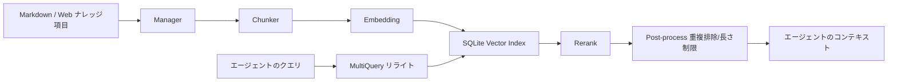

# ナレッジベース

[English](../en-US/knowledge-base.md)

ナレッジベースは、ローカルのセキュリティ知識、脆弱性ハンドブック、テスト手法、組織の経験を検索可能なコンテキストに変換し、エージェントがタスク中に必要に応じて参照できるようにします。

## 有効化

```yaml
knowledge:
  enabled: true
  base_path: knowledge_base
  embedding:
    provider: openai
    model: text-embedding-v4
    base_url: ""
    api_key: ""
database:
  knowledge_db_path: data/knowledge.db
```

`embedding.base_url/api_key` が空の場合は、`openai` の設定を再利用します。移行や再利用がしやすいよう、ナレッジベースのデータベースは独立して保存することを推奨します。

## コンテンツディレクトリ

デフォルトのディレクトリは `knowledge_base/` です。プロジェクトには次のようなサンプルがすでにあります。

```text
knowledge_base/
  SQL Injection/
    README.md
    MySQL Injection.md
  Prompt Injection/
    README.md
```

第 1 階層のディレクトリでリスクタイプや知識領域を表すことを推奨します。例を示します。

- `SQL Injection`
- `XSS`
- `File Upload`
- `Cloud Security`
- `Incident Response`

## 管理フロー

一般的なフローは次のとおりです。

1. Markdown の知識ファイルを `knowledge_base/` に置く。
2. Web のナレッジベースページでディレクトリをスキャンする。
3. インデックスを再構築する。
4. 検索機能でヒット状況を検証する。
5. ロールまたはタスクで、エージェントにナレッジベースを優先して照会するよう指示する。

API の入口は次のとおりです。

- `GET /api/knowledge/categories`
- `GET /api/knowledge/items`
- `POST /api/knowledge/scan`
- `POST /api/knowledge/index`
- `POST /api/knowledge/search`
- `GET /api/knowledge/index-status`
- `GET /api/knowledge/retrieval-logs`

## インデックス

インデックスの設定は次のとおりです。

```yaml
knowledge:
  indexing:
    chunk_size: 512
    chunk_overlap: 50
    max_chunks_per_item: 0
    max_rpm: 0
    rate_limit_delay_ms: 300
    max_retries: 3
    retry_delay_ms: 1000
    chunk_strategy: markdown_then_recursive
    request_timeout_seconds: 120
    prefer_source_file: false
    batch_size: 10
    sub_indexes: []
```

推奨事項は次のとおりです。

- ドキュメントの構造が明確な場合は、`markdown_then_recursive` を使う。
- Embedding API の制限が厳しい場合は、`batch_size` を下げ、`rate_limit_delay_ms` を増やす。
- 1 本のドキュメントが非常に長い場合は、`max_chunks_per_item` を設定してコストを抑えられる。
- 業務領域ごとに分離したい場合は、`sub_indexes` と `sub_index_filter` を使う。

## 検索

```yaml
knowledge:
  retrieval:
    top_k: 5
    similarity_threshold: 0.4
    multi_query:
      max_queries: 4
    post_retrieve:
      prefetch_top_k: 20
      max_context_chars: 0
      max_context_tokens: 0
```

検索の流れはおおむね次のとおりです。

1. ユーザーのクエリまたはエージェントのクエリ。
2. MultiQuery が複数の意味的なバリエーションにリライトする。
3. ベクトル検索で候補チャンクを取得する。
4. rerank で精密にランキングする。
5. 後処理で重複排除と長さ制限を行う。
6. エージェントまたは API の呼び出し元に返す。

`similarity_threshold` が高すぎるとヒット漏れが起き、低すぎるとノイズが混入します。初期値は 0.35 から 0.45 を推奨します。

## Rerank

```yaml
knowledge:
  retrieval:
    rerank:
      provider: ""
      model: ""
      base_url: ""
      api_key: ""
```

空の場合は `base_url` から推定されます。DashScope では `gte-rerank` がよく使われます。その他の OpenAI 互換エンドポイントでは `/v1/rerank` を使う場合があります。プロバイダーが rerank をサポートしていない場合、検索品質が低下する可能性があるため、`top_k` を下げ、ナレッジ項目の品質を高めることを推奨します。

## MCP ツール

ナレッジベースを有効にすると、次のような機能が登録されます。

- リスクタイプの一覧表示。
- ナレッジベースの検索。
- 関連する知識の断片の取得。

ロールのプロンプトには、次のように明記できます。

```text
脆弱性の検証、修正提案、検出方法に不確かな点がある場合は、まずナレッジベースを検索してから結論を出す。
```

## コンテンツ作成の推奨事項

各知識には、次の内容を含めることを推奨します。

- 適用シナリオ。
- 検出方法。
- 検証手順。
- よくある誤検知。
- 修正提案。
- ツールコマンドの例。
- 参考リンクまたは社内標準。

無関係なトピックを 1 本の長い文書に詰め込まないでください。小さく明確な文書のほうが、チャンク分割と検索に適しています。

## トラブルシューティング

インデックス作成に失敗する場合：

- Embedding の API Key、モデル名、base_url を確認する。
- `batch_size` を下げる。
- `request_timeout_seconds` を増やす。
- サービスログで 400/401/429/5xx を確認する。

検索結果が空の場合：

- インデックスを再構築済みか確認する。
- `similarity_threshold` を下げる。
- `categories` でリスクタイプが認識されているか確認する。
- 検索時に、絞り込みすぎた `riskType` を使わない。

ヒットが不正確な場合：

- 見出しの階層を改善する。
- 混在した内容を複数の文書に分割する。
- 重要な用語と同義語を追加する。
- `top_k`、`prefetch_top_k`、rerank の設定を調整する。

## 内部データフロー

ナレッジベースの経路は「全文検索」ではなく、複数段階から成る検索システムです。



したがって、検索品質は 4 つの要素で決まります。原文の構造、チャンクの粒度、Embedding の品質、rerank の利用可否です。`top_k` を調整するだけでは、最も効果的な手段にならないことが多くあります。

## ナレッジ項目の悪い書き方

悪い知識の例：

```text
SQL インジェクションは危険で、sqlmap でスキャンでき、対策はフィルタリングすること。
```

良い知識の例：

```markdown
# MySQL UNION インジェクションの検証

## 発生条件
- パラメーターが SELECT クエリに入り、直接連結されている。
- ページが返すフィールド数が誤っている、または型が誤っている。

## 検証手順
1. `' order by 1-- -` を使って列数を 1 つずつ増やす。
2. `union select null,...` を使って、表示位置を確認する。
3. 読み取り専用の関数でデータベースの種類を確認する。例：`database()`。

## 誤検知の除外
- WAF のインジェクションブロックページが SQL エラーを模倣している場合がある。
- 統一されたエラーページだけでは、インジェクションの直接的な証明にならない。

## 修正
- パラメーター化クエリ。
- 最小限のデータベース権限。
- エラー処理を統一しつつ、セキュリティログは握りつぶさない。
```

2 つ目の書き方は、チャンクに十分な見出し、用語、手順のシグナルを与えられ、エージェントもそのまま実行できます。

## チューニング方法

まず、固定のテスト質問のセットを用意します。例：

```text
MySQL の union インジェクションで、列数はどう判断するか？
SSRF でクラウドのメタデータへのアクセスをどう検証するか？
ファイルアップロードのブラックリスト回避には、どのような誤検知があるか？
```

その後、項目ごとに調整します。

1. 検索結果が空：`similarity_threshold` を下げ、インデックス作成が完了していることを確認する。
2. 結果のテーマが違う：文書の見出しの品質を高め、リスクタイプによるフィルターを追加する。
3. 結果の断片が途切れている：`chunk_overlap` を増やすか `chunk_size` を下げてから、インデックスを再構築する。
4. ノイズが多い：`similarity_threshold` を上げ、rerank を有効化/修復する。
5. コストが高い：`multi_query.max_queries`、`prefetch_top_k`、`top_k` を下げる。

毎回 1 つのパラメーターだけを変更し、クエリ結果を記録してください。そうしないと、どの変数が効いたのか判断できません。

## 検索ログの活用方法

検索ログはトラブルシューティングだけでなく、ナレッジベースを逆方向から改善するためにも使えます。

- 結果なしの頻出クエリ：知識の不足、または同義語の不足を示す。
- 低スコアの頻出クエリ：文書の見出しと用語が合っていないことを示す。
- 同じ質問で重複した文書が複数ヒットする：統合するか、category を追加する必要があることを示す。
- エージェントがナレッジベースの結果をよく無視する：結果が長すぎる、散漫である、または明確な結論がないことを示す。

## ソースコードのアンカー

- ナレッジ管理：`internal/knowledge/manager.go`
- インデックス作成パイプライン：`internal/knowledge/index_pipeline.go`
- ネイティブのチャンク分割：`internal/knowledge/splitter.go`
- リトリーバー：`internal/knowledge/retriever.go`
- ネイティブの検索チェーン：`internal/knowledge/retrieve_chain.go`
- rerank：`internal/knowledge/rerank_http.go`
- MCP ツール：`internal/knowledge/tool.go`
